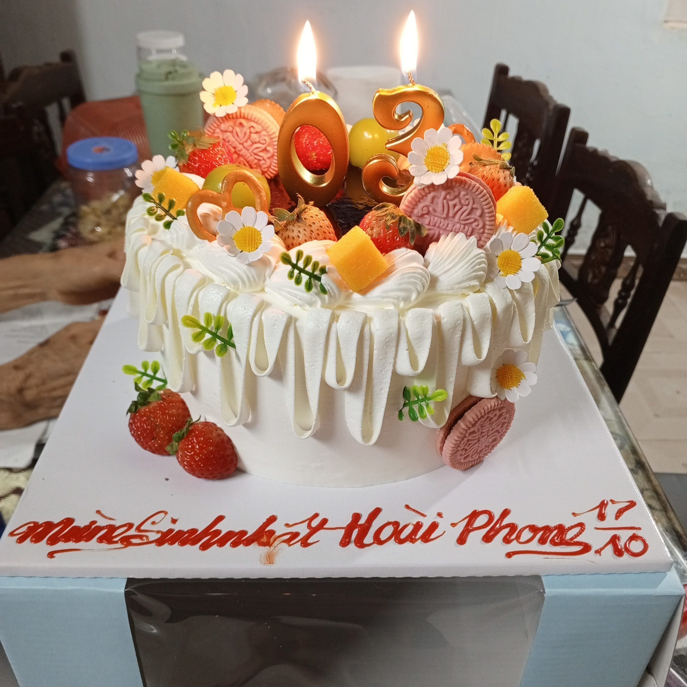
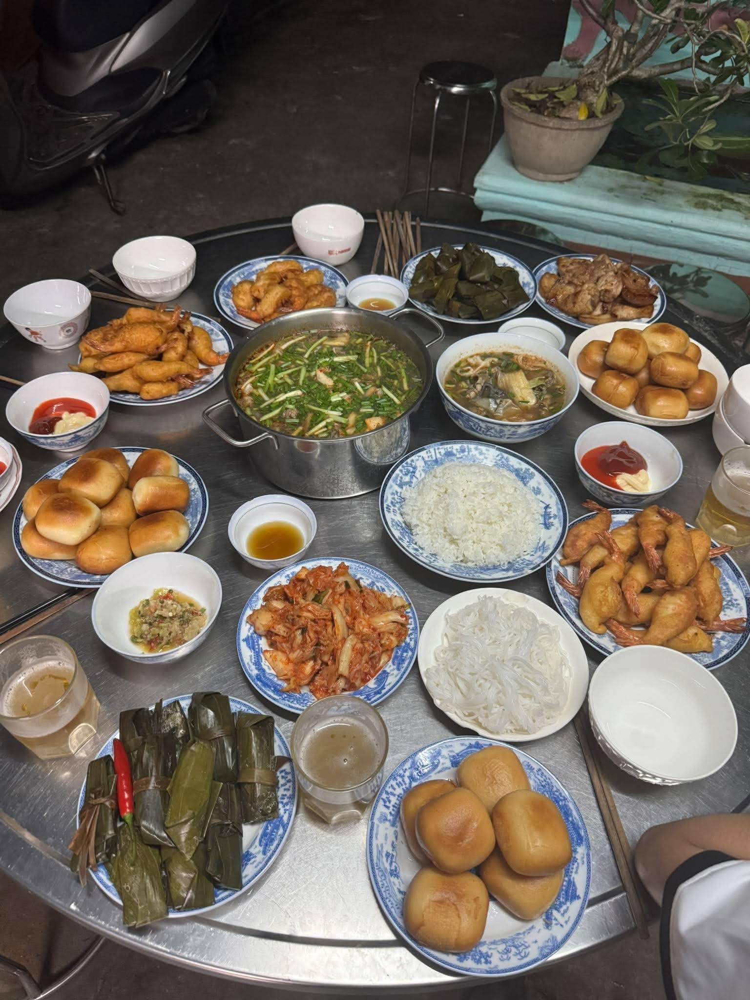
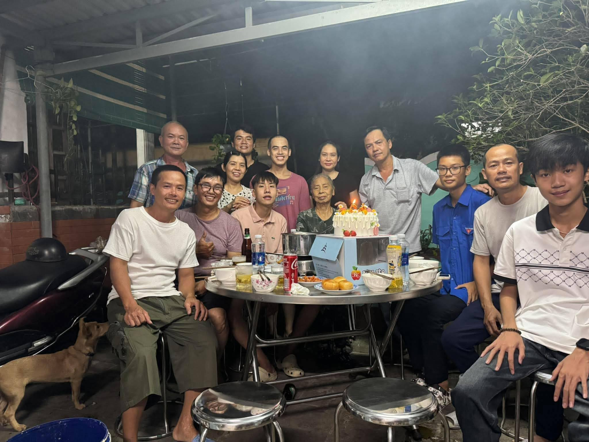
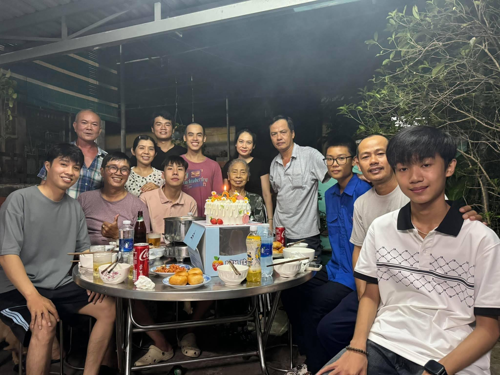
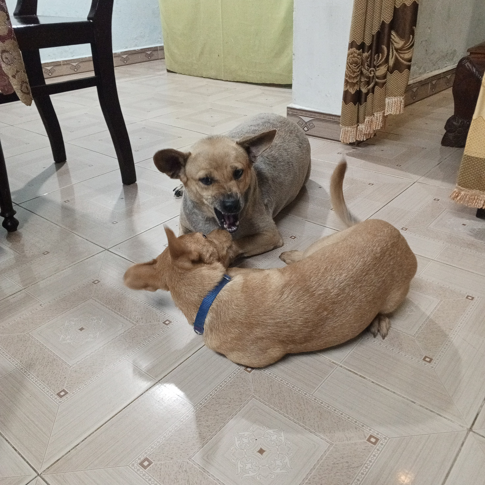
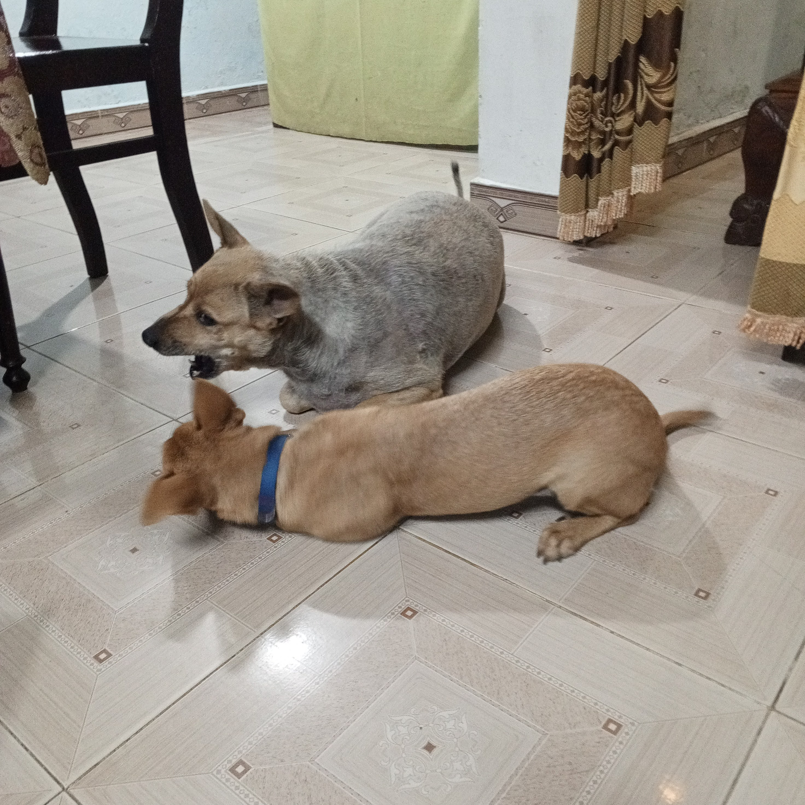
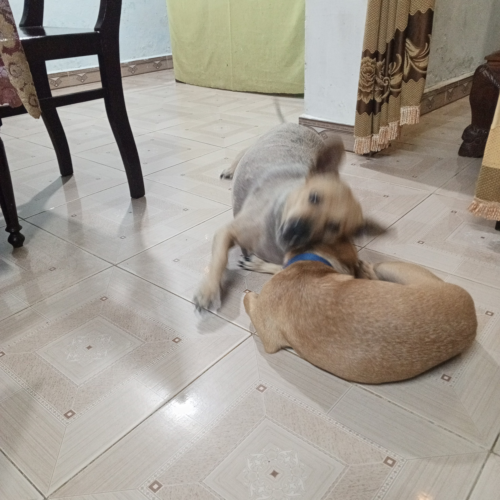
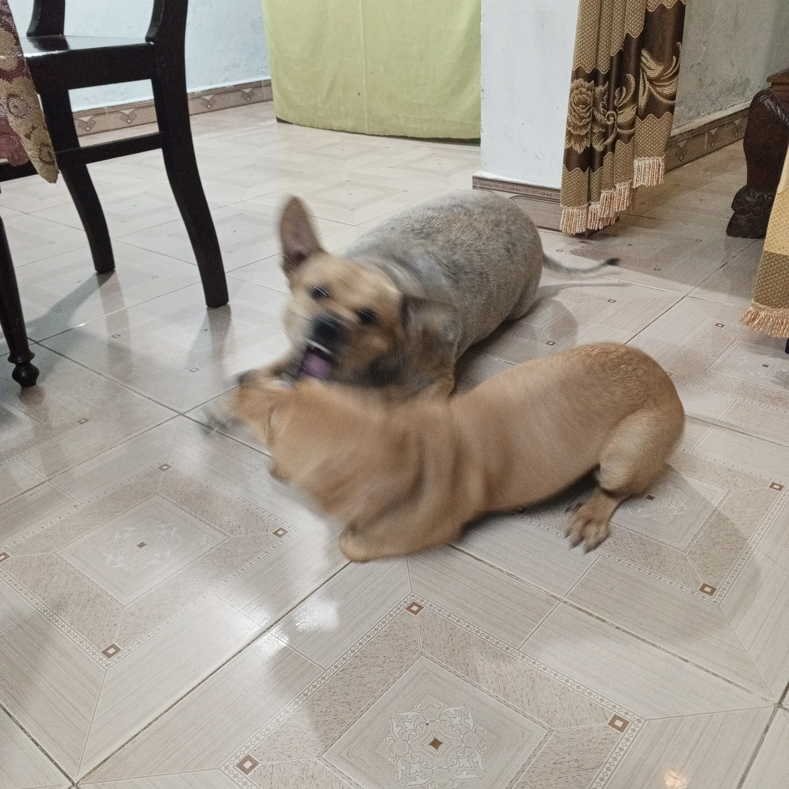
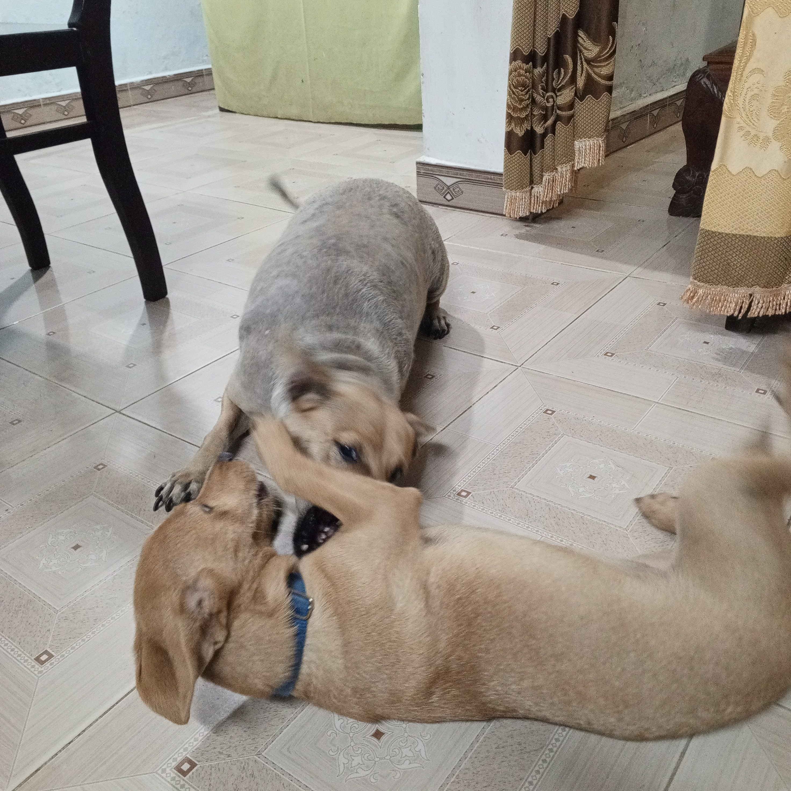

This morning, I went to school for a medical examination

After that, I went to the Winmart+ on Bui Thi Xuan Street to buy some kimchi for my birthday party

I stopped by Aunt Thuy's house and gave her a box

In the evening, I picked up Brother Phim and Vang from Aunt Roi's house

Tonight Uncle Mep and her youngest son, Uncle Tem and Ka, Aunt Roi's, Aunt Thuy's, and Uncle Chinh's families joined my birthday party

We grilled some meat

